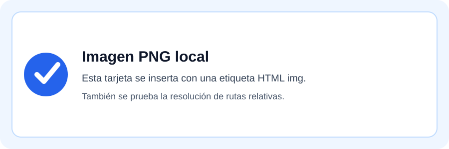

# 5. Imágenes y recursos locales

## 5.1 Imagen PNG desde Markdown

*Figura 1. Imagen PNG insertada con sintaxis Markdown y título.*

## 5.2 Imagen SVG desde HTML

<figure style="text-align: center; margin: 2em 0;">
  
  <figcaption>Figura 2. Imagen SVG local insertada con una etiqueta HTML.</figcaption>
</figure>

## 5.3 Enlaces

- [Documentación de Mermaid](https://mermaid.js.org/)
- [Documentación de WeasyPrint](https://weasyprint.org/)
- [Documentación de Python-Markdown](https://python-markdown.github.io/)

## 5.4 Rutas relativas

Las imágenes se resuelven respecto a la carpeta del documento. En este caso, la
carpeta `assets/` está dentro de `docs/markdown/Demo_Funcionalidades/`.

También se pueden usar rutas con subcarpetas, por ejemplo
`assets/tarjeta-demo.png`, y el compilador se encarga de convertir la ruta a una
URI absoluta para que WeasyPrint encuentre el archivo.
